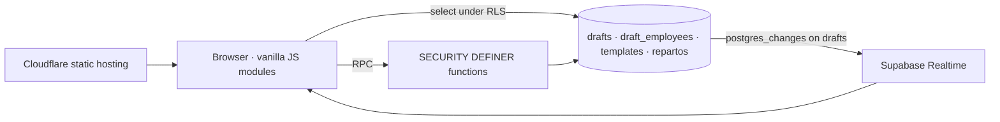

# El Sauce — Tip Distribution System (v3)

A mobile-friendly, multi-user web app that splits a restaurant's tip pool across departments using performance weights and attendance. Two managers can edit the same distribution at the same time from different devices. Closed distributions are stored as immutable, cent-exact records.

> **Status:** MVP in operational use at a single restaurant. v3 is a redesign of the collaborative draft. It was built test-first against a local PostgreSQL that emulates Supabase's auth and RLS model. A public demo is not provided because the live instance holds private business data.

## What changed in v3

| Problem in v2 | v3 approach |
|---|---|
| The draft was one JSON document patched by array index. A concurrent removal could shift indexes and apply an edit to the **wrong employee**. | Employees are rows with stable UUIDs (`draft_employees`). Every edit targets `(employee_id, field)`. |
| A value rejected by the server was retried every 850 ms forever. | Validation errors (`22023`) are final: the edit is dropped and the user is told why. Only network or transient errors are retried, with exponential backoff. |
| Remote updates re-rendered the whole table and wiped input the user was still typing. | Keyed DOM reconciliation; a focused input is never overwritten. |
| Per-person rounding left the total a few cents off. | Integer-cent **largest-remainder** allocation, at both department and employee level. Payouts always sum to the total. |
| The payout formula was duplicated in JS and SQL and the server only checked the client's numbers. | The server computes payouts itself when closing. The JS copy is only for preview, and 3,000 randomized cases check that both produce identical cents. |
| Any member could insert arbitrary history rows directly. | All writes go through `SECURITY DEFINER` RPCs. `05_activar_produccion.sql` removes direct inserts. |
| Anyone could sign up and create a workspace. Members could not be removed. | Single-tenant workspace creation. Owner-only `remove_member`. Members are listed by email. |

## Concurrency model

- **Field-level compare-and-set:** each edit sends `before` (the value the user saw) and `after`. The server writes only if the stored value still equals `before`.
  - Edits to different fields merge automatically.
  - Edits to the same field produce a conflict. The user then chooses *keep mine* or *use current*.
- **Revision-guarded bulk operations:** loading a template, resetting and closing require the draft's current `revision`. This prevents one person from wiping or closing over changes they have not seen yet.
- **Realtime:** clients subscribe to the single `drafts` row per workspace; every change bumps its `revision`.
  - On notification, a client re-reads the draft and re-applies its pending local edits on top. A pending edit whose base value changed becomes a conflict before it is sent.
  - Presence shows who else is editing.
  - If realtime is down, the client polls every 20 s.
- Changes are serialized per workspace with a row lock (`SELECT … FOR UPDATE`).

## Architecture

| Path | Responsibility |
|---|---|
| `js/calc.js` | Pure allocation and validation logic. Mirrors `tip_compute` / `tip_validate`. |
| `js/sync.js` | DOM-free draft synchronization: pending edits, conflicts, retries, bulk operations. |
| `js/draft-view.js` | Draft screen rendering and input handling. |
| `js/panels.js` | Templates (with optimistic `updated_at` check), history, members. |
| `supabase/04_rediseno.sql` | Idempotent migration. Works on top of the v1 schema with or without the v2 scripts, and migrates any v2 JSON draft. |

## Tests

`tests/run-all.sh` runs everything against a local PostgreSQL 16 that emulates Supabase roles, `auth.uid()` and default grants (`tests/sql/00_supabase_stub.sql`):

- **Unit:** the allocation and cent reconciliation.
- **Cross-check:** 3,000 randomized drafts compared between JS and SQL (cents and validation messages).
- **Server:**
  - RLS and denied direct writes;
  - field conflicts and the index-shift regression;
  - closing;
  - member removal;
  - the migration from v2;
  - the production lock-down.
- **Two-client sync:** two `DraftSync` instances against the real database (merges, conflicts, removals, offline retry, stale close).
- **End-to-end:** two Chrome sessions via Playwright, with a test double of `supabase-js` that executes queries in PostgreSQL under the `authenticated` role, so RLS applies. Includes a mobile viewport check.

## Business rules

- **Department fund:** `total × department %`. The three percentages must add up to exactly 100.
- **Employee share:** `fund × (weight × days worked) / Σ(area)`.
- **Exclusions:** any unjustified absence, or an inactive status, sets that employee's share to zero. This rule requires labor-law review before it is enforced.
- **Closing is blocked** if a department has money but no eligible employees.

## Setup

See [`INSTALACION.md`](INSTALACION.md) (Spanish). In short:

1. Run `01_schema_base.sql` (new projects only), then `04_rediseno.sql`.
2. Deploy the static files together with a `config.js` that holds the project URL and publishable key.
3. After switching clients, run `05_activar_produccion.sql`.

Never put a secret or service-role key in client code. Keep `config.js` out of version control.

## Roadmap

- Audit log of draft edits.
- Configurable department list and absence policy.
- Offline drafts (IndexedDB).
- Pin the `supabase-js` version and vendor it.

## License

Source available for portfolio review. All rights reserved; not an open-source license.
