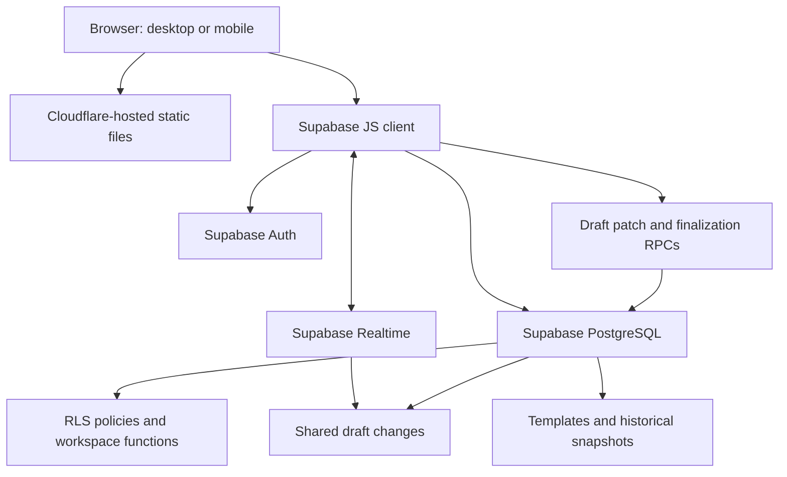

# El Sauce — Tip Management System

A mobile-accessible, multi-user web application for allocating restaurant tips across teams, applying attendance and performance weights, managing reusable employee templates, and maintaining historical distributions. Built around a shared Supabase workspace, it supports persistent drafts and real-time collaboration across devices.

> **Status:** Deployed MVP used in an operational workflow. Draft persistence and collaborative editing have been implemented and manually exercised. Financial integrity, authorization, and concurrency controls require further automated and adversarial testing before the system can be considered fully validated for production payroll/tip payments. A public demo is not provided because the live instance contains private business data.

## The problem

Manual tip distribution becomes error-prone when multiple departments share a pool, employees have different performance weights, and attendance varies by period. Managers need a consistent record that can be accessed across devices without emailing spreadsheets.

A further operational challenge arises when a distribution cannot be finalized immediately: attendance and allocation data may already be entered, but the total tip pool may still change. Losing that work—or maintaining separate versions across devices—creates unnecessary re-entry and reconciliation risks. Collaborative drafts address that gap.

## Implemented features

- Default department split: **Kitchen 45% / Waitstaff 40% / Administration 15%**, editable per distribution.
- Individual adjustable performance weights and proportional attendance adjustment.
- Combined field for rest days and justified absences; a separate unjustified-absence field.
- Optional reusable employee templates with editable membership and active status.
- Email/password sign-in through Supabase Auth and multi-user workspaces joined through single-use invitation codes.
- **Persistent shared drafts:** in-progress distributions are saved in Supabase and restored after a browser refresh or a new session.
- **Real-time collaboration:** authorized members of the same workspace can receive updates to a shared draft without manually refreshing the page.
- **Field-level optimistic concurrency:** updates compare the previously observed field value with the stored value, allowing independent field changes while detecting conflicting edits to the same field.
- **Transactional finalization:** the server checks the draft revision before recording a finalized distribution and clearing the draft within one database transaction.
- Closed distributions saved as snapshots; historical distributions remain unchanged when templates are edited.
- CSV export of current calculations.
- Responsive web UI, hosted as static assets on Cloudflare Workers.

**Important policy note:** The current implementation assigns zero tips to an employee with any unjustified absence in the period. This rule must undergo local labor-law review before operational enforcement.

## Technology

| Layer | Technology |
|---|---|
| UI | HTML, CSS, vanilla JavaScript |
| Client API | Supabase JavaScript SDK v2 (ES module via CDN) |
| Identity | Supabase Auth |
| Database | Supabase PostgreSQL, JSONB drafts and historical snapshots |
| Authorization | PostgreSQL Row Level Security and database functions |
| Real-time communication | Supabase Realtime (Postgres change notifications) |
| Concurrency and finalization | PostgreSQL functions, field comparisons, draft revision checks, transactions |
| Hosting | Cloudflare Workers static hosting |

## Architecture

The browser communicates directly with Supabase; Cloudflare serves the static application. No custom application server is required. Draft edits are persisted through database functions, while Realtime notifications allow other connected clients to refresh their view of the shared state. The draft is scoped to a workspace rather than to an individual browser session.

## Getting started

1. Create a Supabase project and enable email authentication.
2. Review the bootstrap schema (`schema.sql` in the repository), then run it in the Supabase SQL Editor **on a new project only**. The script is a bootstrap schema, not a general-purpose migration framework.
3. Apply `supabase/02_borradores.sql` to add persistent workspace drafts and their access policies. Then review and apply `supabase/03_realtime_revisado.sql` to add revision-based editing and transactional finalization. These SQL files should be reviewed against the target schema and tested in a non-production environment before use.
4. Enable the `public.reparto_borrador` table in the `supabase_realtime` publication if it has not already been added. Do not add the same table to the publication twice.
5. Copy `config.example.js` to `config.js` and replace the example URL and publishable key. Use the **project base URL** (`https://PROJECT_REF.supabase.co`), **not** a URL ending in `/rest/v1`.
6. Serve `index.html`, `app.js`, and `config.js` together over HTTPS using static hosting. `app.js` uses an ES module and imports the Supabase SDK from a CDN.
7. Configure Supabase Auth Site URL / permitted redirects to match your hosted URL.
8. Register, confirm email if enabled, sign in, and create a workspace. Invite additional accounts using the workspace invitation feature.
9. With two authorized accounts, verify draft recovery, cross-device updates, conflicting edits, and finalization using test data before relying on the application for financial operations.

**Never place a Supabase secret/service-role key, database password, or user token in client-side code.** The publishable key is intended for public clients, provided RLS is correctly configured. Do not commit environment-specific `config.js` to the repository; keep a placeholder-only `config.example.js`.

## Business rules

See [`docs/business-rules.md`](docs/business-rules.md) for the precise formula, validations, examples, and known rounding limitations. The calculation model remains based on department allocation, individual weights, and attendance; draft persistence does not change the underlying allocation policy.

## Security and limitations

See [`docs/security-and-limitations.md`](docs/security-and-limitations.md). In-progress drafts are now persisted in Supabase, scoped to a workspace, and synchronized through Realtime. Database functions use revision checks and field-level comparisons to reduce accidental overwrites, but this is **not** a full collaborative document engine or a substitute for comprehensive concurrency testing.

The MVP does **not** provide full audit trails, in-app member revocation, automated backups, or deterministic cent-level payout reconciliation. Structural changes to an employee list may conflict with simultaneous edits. Financial snapshots and authorization rules still require comprehensive integration and security testing.

## Project documentation

- [Architecture](docs/architecture.md)
- [Business rules](docs/business-rules.md)
- [Security and limitations](docs/security-and-limitations.md)
- [Manual test plan](docs/test-plan.md)
- [Screenshots guide](docs/screenshots.md)

## Engineering decisions

- **Supabase over a custom backend:** managed authentication, database, Realtime, and RLS with minimal operational overhead.
- **Workspace-scoped drafts over local browser state:** preserve unfinished work across sessions and authorized users.
- **Field-level optimistic concurrency over whole-draft overwrites:** merge independent updates while explicitly detecting stale edits to the same value.
- **Transactional finalization over separate client writes:** check the current revision and persist the historical record as part of a single database operation.
- **Snapshots over live recalculation:** preserve historical payout records even if templates or weights later change.
- **Configurable weighted distribution:** avoids hard-coding department or individual shares.
- **Static hosting:** low-cost, accessible from multiple devices without maintaining a server.

## Roadmap

- Deterministic cent reconciliation and server-side payout integrity checks.
- Automated tests for allocation formulas, RLS policies, finalization, and concurrent usage.
- Improved handling of simultaneous employee-list edits and clearer conflict-resolution UX.
- Member revocation, role-based permissions, and audit logs.
- Backup and restore drills; password recovery and operational monitoring.
- Review labor-law compliance and tip-distribution policy.

## Privacy

All example data in this repository should be fictional. Do not commit real employee names, emails, wages, distribution history, invitation codes, or screenshots containing personal data. Keep environment-specific configuration files and credentials out of version control.

## License

Source available for portfolio review; see [LICENSE](LICENSE). This is not an open-source license.
