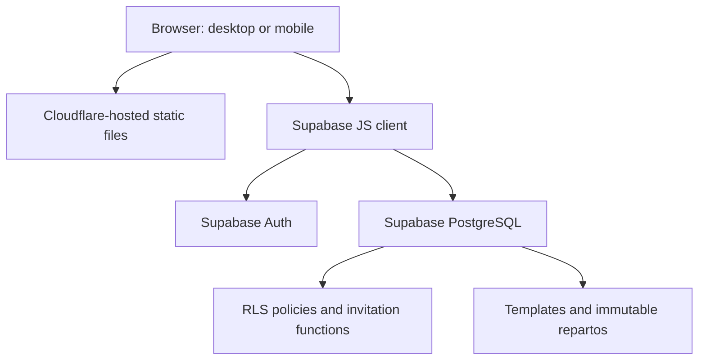

# El Sauce — Tip Management System

A mobile-accessible web application for allocating restaurant tips across teams, applying attendance and performance weights, managing reusable employee templates, and storing historical distributions in a shared Supabase workspace.

> **Status:** Deployed MVP used for an operational workflow. Financial and security controls require additional testing before reliance on production payroll/tip payments. The public demo is not provided here because the live instance contains private business data.

## The problem

Manual tip distribution becomes error-prone when multiple departments share a pool, employees have different performance weights, and attendance varies by period. Managers also need a consistent record that can be accessed across devices without emailing spreadsheets.

## Implemented features

- Default department split: **Kitchen 45% / Waitstaff 40% / Administration 15%**, editable per distribution.
- Individual adjustable performance weights and proportional attendance adjustment.
- Combined field for rest days and justified absences; a separate unjustified-absence field.
- Optional reusable employee templates with editable membership and active status.
- Email/password sign-in through Supabase Auth and multi-user workspaces joined through single-use invitation codes.
- Closed distributions saved as snapshots; historical distributions remain unchanged when templates are edited.
- CSV export of current calculations.
- Responsive web UI, hosted as static assets on Cloudflare Workers.

**Important policy note:** The current implementation assigns zero tips to an employee with any unjustified absence in the period. This rule must undergo local labor-law review before operational enforcement.

## Technology

| Layer | Technology |
|---|---|
| UI | HTML, CSS, vanilla JavaScript |
| Client API | Supabase JavaScript SDK v2 (ES module via CDN) |
| Identity | Supabase Auth |
| Database | Supabase PostgreSQL, JSONB snapshots |
| Authorization | PostgreSQL Row Level Security and database functions |
| Hosting | Cloudflare Workers static hosting |

## Architecture

The browser communicates directly with Supabase; Cloudflare serves the static application. No custom application server is required.

## Getting started

1. Create a Supabase project and enable email authentication.
2. Review `supabase/schema.sql`, then run it in the Supabase SQL Editor **on a new project only**. The script is a bootstrap schema, not a migration framework.
3. Copy `config.example.js` to `config.js` and replace the example URL and publishable key. Use the **project base URL** (`https://PROJECT_REF.supabase.co`), **not** a URL ending in `/rest/v1`.
4. Serve `index.html`, `app.js`, and `config.js` together over HTTPS using static hosting. `app.js` uses an ES module and imports the Supabase SDK from a CDN.
5. Configure Supabase Auth Site URL / permitted redirects to match your hosted URL.
6. Register, confirm email if enabled, sign in, and create a workspace. Invite additional accounts using the workspace invitation feature.

**Never place a Supabase secret/service-role key, database password, or user token in client-side code.** The publishable key is intended for public clients, provided RLS is correctly configured.

## Business rules

See [`docs/business-rules.md`](docs/business-rules.md) for the precise formula, validations, examples, and known rounding limitations.

## Security and limitations

See [`docs/security-and-limitations.md`](docs/security-and-limitations.md). In particular, this MVP does **not** provide full audit trails, in-app member revocation, automated backups, or cent-level reconciliation. In-progress drafts are not persisted across sessions.

## Project documentation

- [Architecture](docs/architecture.md)
- [Business rules](docs/business-rules.md)
- [Security and limitations](docs/security-and-limitations.md)
- [Manual test plan](docs/test-plan.md)
- [Screenshots guide](docs/screenshots.md)

## Engineering decisions

- **Supabase over a custom backend:** managed authentication, database and RLS with minimal operational overhead.
- **Snapshots over live recalculation:** preserve historical payout records even if templates or weights later change.
- **Configurable weighted distribution:** avoids hard-coding department or individual shares.
- **Static hosting:** low-cost, accessible from multiple devices without maintaining a server.

## Roadmap

- Deterministic cent reconciliation and payout integrity checks.
- Automated tests for formulas, RLS policies, and concurrent usage.
- Member revocation, role-based permissions, and audit logs.
- Backup and restore drills; password recovery and operational monitoring.
- Review labor-law compliance and tip-distribution policy.

## Privacy

All example data in this repository should be fictional. Do not commit real employee names, emails, wages, distribution history, invitation codes, or screenshots containing personal data.

## License

Source available for portfolio review; see [LICENSE](LICENSE). This is not an open-source license.
